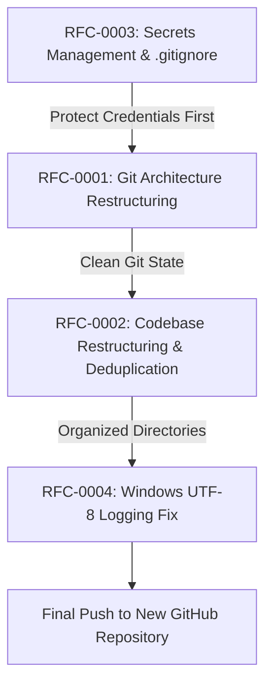

# RFC Roadmap: Agentify Platform Stabilization & GitHub Migration

This directory contains the Request for Comments (RFC) specifications addressing architectural, structural, security, and runtime issues discovered in the **Agentify** codebase.

## RFC Index

| RFC ID | Title | Status | Priority | Description |
| :--- | :--- | :--- | :--- | :--- |
| [RFC-0001](./RFC-0001-git-architecture-and-monorepo-initialization.md) | **Git Architecture Restructuring & Clean Repository Initialization** | Proposed | High (P0) | Eliminates nested `.git` repositories and broken submodule pointers to establish a unified root repository ready for new GitHub publishing. |
| [RFC-0002](./RFC-0002-codebase-restructuring-and-deduplication.md) | **Codebase Restructuring, Deduplication & Conflict Resolution** | Proposed | High (P0) | Separates concerns into dedicated `frontend/` and `backend/` folders, resolves merge conflict markers in backend configs, and purges duplicate frontend code from the backend. |
| [RFC-0003](./RFC-0003-secrets-management-and-security-hardening.md) | **Secrets Management & Security Hardening** | Proposed | Critical (P0) | Replaces invalid `.gitignore.txt` with root `.gitignore`, protects sensitive credentials (Gemini, Neon, Brevo, GitHub PAT), and introduces sanitized example config templates. |
| [RFC-0004](./RFC-0004-windows-utf8-logging-resilience.md) | **Windows Console Encoding & Cross-Platform Logging Resilience** | Proposed | Medium (P1) | Fixes Python `UnicodeEncodeError` (`charmap` codec) on Windows PowerShell/CMD caused by terminal emojis by implementing automated UTF-8 stream handling. |

---

## Execution Sequence

> **Safety Notice:** RFC-0003 (Securing Secrets) is recommended to be executed before or alongside RFC-0001 to guarantee no sensitive credentials are ever staged or committed during the repository migration.
